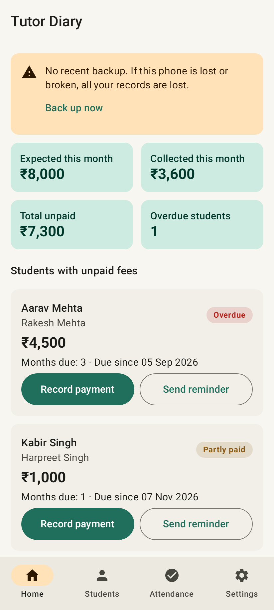
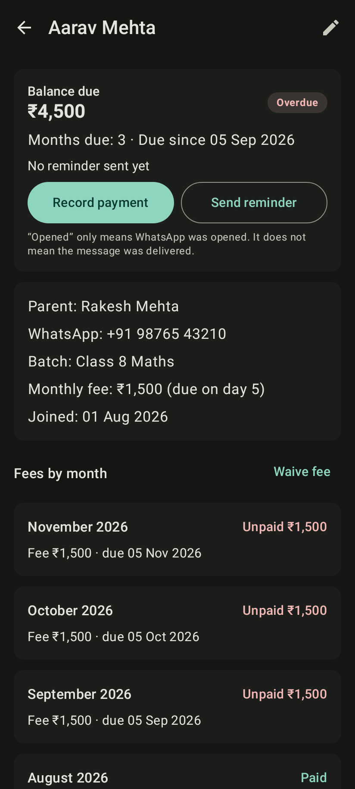
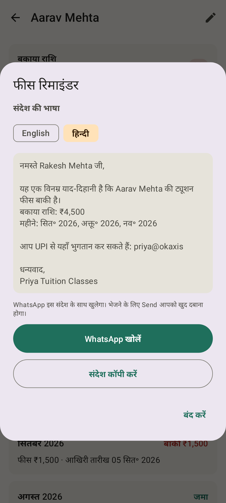
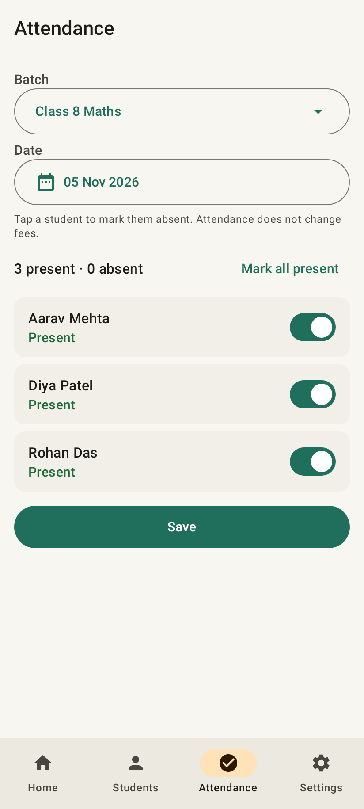

# Tutor Diary

A simple Android app for home tutors in India. Track students, attendance and unpaid fees, and send polite fee reminders on WhatsApp. Students and parents can sign in to see their own fees and attendance.

- Two logins (both "Sign in with Google"): **tutor** and **student/parent**.
- The tutor's full records stay on the tutor's phone and work offline. Only invited students' summaries go online.
- No ads, no tracking.
- English and Hindi.
- Min Android 8.0 (API 26). Target/compile SDK 36.

## Screenshots

| Home | Student | Reminder (Hindi) | Attendance |
|---|---|---|---|
|  |  |  |  |

More in [`docs/screenshots`](docs/screenshots) (English, dark mode, Hindi). They are made automatically by `ScreenshotTour` on a simulated Android phone, with sample data.

---

## 0. Logins (tutor and student/parent)

**How it works**
1. First screen: *Who is using this phone?* → **I'm the tutor** or **I'm a student or parent**.
2. Both sign in with Google (free; no passwords, no SMS).
3. Tutor: open a student → **Manage student app access** → **Make invite code** → **Send code on WhatsApp**.
4. Parent: installs the app → *I'm a student or parent* → signs in → types the 6-letter code.
5. The parent now sees only that student's fees due, payments, attendance and the tutor's UPI ID. Read-only. Updates arrive whenever the tutor's phone is online.

Each code works once. "Make a new code" lets one more person join (e.g. student *and* parent). "Remove access" unlinks everyone.

**What goes online** (Firebase Firestore): for invited students only — name, parent name, fee, amount due, unpaid months, last 24 payments, last 6 months' attendance counts, tutor name and UPI ID. **Never**: parent phone numbers, notes, uninvited students.

**Security rules**: `firestore.rules` decides who can read/write. They are tested on every build against the real Firestore emulator (`rules-test/`). You must paste them into Firebase (step 6 below).

### One-time Firebase setup (the tutor/owner does this)
1. https://console.firebase.google.com → **Create project** `tutor-diary` (Analytics off).
2. **Build → Authentication** → Get started → **Google** → Enable → Save.
3. **Build → Firestore Database** → Create → location **asia-south1** → production mode.
4. Project settings → **Add app → Android**: package `com.tutordiary.app.test`, SHA-1 `DF:CE:B9:54:E7:07:24:3A:6A:C7:80:4A:E5:F1:48:9E:48:57:C5:11` (the public test key).
5. Add a second Android app: package `com.tutordiary.app` (add your **upload key** and **Play app-signing key** SHA-1 later, from Play Console → App integrity).
6. **Firestore → Rules**: paste the contents of `firestore.rules` → **Publish**.
7. Download **`google-services.json`** (after steps 4–5) and put it in `app/`.

Without `google-services.json` the app still builds and runs, but sign-in is switched off (the tutor can use it offline on one phone).

## 1. Try it on your phone (test build)

Every time code is pushed to `main`, GitHub builds the app, runs all tests, and publishes a test APK.

1. On your Android phone, open: **https://github.com/amitvayuyantra/tutor-app/releases/tag/test-build**
2. Tap **TutorDiary-test.apk** to download it.
3. Open the downloaded file. If Android asks, allow "Install unknown apps" for your browser.
4. Install and open **Tutor Diary**.

Notes:
- The test app is called "Tutor Diary" and installs **next to** a future Play Store version (its ID ends in `.test`).
- It is signed with a **public test key** kept in this repo (`keystore/test.keystore`). Fine for testing. **Never** use it for the Play Store.
- New test builds install over the old one and keep your data.

## 2. Run it from source

1. Install **Android Studio** (latest stable).
2. *File → Open* → choose this folder. Wait for Gradle sync.
3. Press **Run ▶** with a phone (USB debugging on) or an emulator.

Command line:
```bash
./gradlew testDebugUnitTest   # run all tests
./gradlew assembleDebug       # test APK → app/build/outputs/apk/debug/app-debug.apk
```

## 3. Create a signed release App Bundle (for Google Play)

You need your own **upload key**. Make it once and keep it safe (lose it = you can't easily update the app).

**Step 1 – make the key** (needs Java's `keytool`, included with Android Studio):
```bash
keytool -genkeypair -v -keystore tutor-diary-upload.jks -alias upload \
  -keyalg RSA -keysize 2048 -validity 10000
```
Keep the `.jks` file and both passwords somewhere safe (not in this repo).

**Step 2a – build on your computer:**
```bash
export RELEASE_KEYSTORE_PATH=/full/path/to/tutor-diary-upload.jks
export RELEASE_STORE_PASSWORD='your-store-password'
export RELEASE_KEY_ALIAS=upload
export RELEASE_KEY_PASSWORD='your-key-password'
./gradlew bundleRelease
```
Output: `app/build/outputs/bundle/release/app-release.aab` → upload it in Play Console.

**Step 2b – or let GitHub build it:** in the repo go to *Settings → Secrets and variables → Actions* and add:

| Secret | Value |
|---|---|
| `RELEASE_KEYSTORE_BASE64` | output of `base64 -w0 tutor-diary-upload.jks` (macOS: `base64 -i tutor-diary-upload.jks`) |
| `RELEASE_STORE_PASSWORD` | store password |
| `RELEASE_KEY_ALIAS` | `upload` |
| `RELEASE_KEY_PASSWORD` | key password |

The next build then signs the bundle. Download it from the run's **Artifacts** (`tutor-diary-outputs`).

Before each Play release, raise `versionCode` (and `versionName`) in `app/build.gradle.kts`.

## 4. Permissions

The app requests **no permissions that show a pop-up** to the user. Checked on the built release APK with `aapt dump permissions`:

| Permission | Why |
|---|---|
| `INTERNET`, `ACCESS_NETWORK_STATE` | Google sign-in, and sharing invited students' summaries. |
| `com.tutordiary.app.DYNAMIC_RECEIVER_NOT_EXPORTED_PERMISSION` | Added automatically by AndroidX. Internal, signature-level; lets the app's own components talk to each other safely. Not shown to users. |

Not requested: SMS, Call log, Contacts, Storage, Location, Photos, Camera. `allowBackup="false"` and data-extraction rules block Android's own cloud backup and device transfer of the tutor's records.

## 5. How fees work (plain words)

- Each student gets **one fee per month**, created on the 1st of the month. The month they join is charged in full; so is the month they're archived.
- No fees before the join month or after the archive month. If an archived student is made active again, fees restart from that month (the gap is not charged).
- If the due day doesn't exist (e.g. 31 in February), the **last day of that month** is used.
- A fee is **due** until its due date and **overdue** from the next day.
- Changing a student's fee affects **next month onwards**. Past months keep their old amount.
- Opening the app any number of times never creates duplicate fees (also enforced by the database). If the app wasn't opened for months, all missing months are added next time.
- Payments aren't tied to a month: they pay off the **oldest unpaid month first**. Paying more than due shows an **advance (credit)**.
- **Balance = fees − waivers − payments.** A waiver is for one month, needs a reason, and can't exceed that month's fee.
- Money is stored as whole rupees (`Long`). No decimals anywhere.

## 6. WhatsApp reminders

The app opens `https://wa.me/<number>?text=<message>`. **Nothing is sent automatically** – the tutor must press Send in WhatsApp. The app records "reminder opened", which does **not** mean delivered. If WhatsApp can't be opened, the message can be copied instead. Templates (English and Hindi) can be edited in *Settings → Edit reminder messages*.

## 7. Backup

*Settings → Create backup* writes a versioned JSON file to a place you choose. *Restore backup* checks the whole file first, warns that it will replace everything, and restores in a single all-or-nothing database transaction. CSV exports for students and fee balances are also in Settings.

## 8. Project layout

```
app/src/main/java/com/tutordiary/app/
  domain/        pure logic: billing, ledger, money, phone, reminder text, CSV
  data/db/       Room entities, DAOs, database
  data/repo/     TutorRepository (all reads/writes, transactions)
  data/backup/   backup file format, validation
  ui/            Compose screens + ViewModels (home, students, attendance, batches, settings)
app/src/test/    unit tests (JVM) + database tests (Robolectric)
docs/            privacy policy and Play Data Safety drafts
```

Stack: Kotlin, Jetpack Compose (Material 3), MVVM, Room, Hilt, kotlinx.serialization.

## 9. Test results

All tests run automatically on GitHub for every push (see the **Actions** tab). Latest run: **60 passed, 0 failed**.

| Test group | Tests | What it checks |
|---|---|---|
| `BillingTest` | 11 | Monthly charges, no duplicates, catch-up after months away, due day 31 in short months and leap years, join/archive boundaries, un-archive gap, fee change, year boundary |
| `LedgerTest` | 11 | Balance = fees − waivers − payments, partial and advance payments, oldest-month-first, due vs overdue, waiver limits |
| `TutorRepositoryTest` | 14 | Same rules against the real database: duplicate-proof charges, catch-up, fee change only affects future, archive/un-archive, waivers, zero/negative payments rejected, permanent delete, attendance save/edit, backup → restore round trip, failed restore leaves data untouched |
| `BackupCodecTest` | 6 | Backup file round trip; rejects non-JSON, other apps, newer versions, broken links and bad values |
| `PhoneNumbersTest` | 3 | Indian mobile validation and +91 normalising |
| `ReminderTest` | 4 | Reminder text, UPI line removed when no UPI, Hindi months, wa.me link encoding |
| `MoneyTest`, `CsvTest` | 4 | ₹1,50,000 formatting, parsing, CSV escaping |
| `LanguageTest` | 2 | English and Hindi text load |
| `ScreenPartsTest`, `StudentPageTest` | 4 | Screens draw and settle (no endless redrawing) |
| `AppFlowTest` | 1 | Opens the real app and taps through it: setup → add student (with a wrong number first) → record part payment → WhatsApp reminder (checks the wa.me link) → waive a month → create batch → attendance → settings |

The screen tests run on a simulated Android (Robolectric), not on a real phone.

## 10. Known limitations

**Not checked on a real phone yet.** Everything above was tested on GitHub's computers with a simulated Android. Not yet seen on a real device:
- How it looks (light/dark mode, big font sizes, Hindi text fitting, small screens).
- Real WhatsApp opening, the system file picker (backup, restore, CSV) and the calendar picker.
- Speed on low-end phones.
- The release (shrunk) build was built but never opened. The test APK is the debug build.

**By design in this version:**
- One batch per student. Join month and archive month are charged in full (no part-month fees; use a waiver).
- Payments aren't tied to a month; they clear the oldest unpaid month first.
- A fee change starts next month. To change this month's amount, use a waiver.
- Moving a join date later removes fees before the new month. Moving it earlier adds fees at the current fee.
- If WhatsApp isn't installed, the wa.me link may open in a web browser instead of showing the copy option.
- "Reminder opened" never means "delivered".
- Backup files are not encrypted, and there's no automatic backup. The tutor must make and store backups.
- This repo is public, including the **test** signing key (safe: it's only for test builds).
